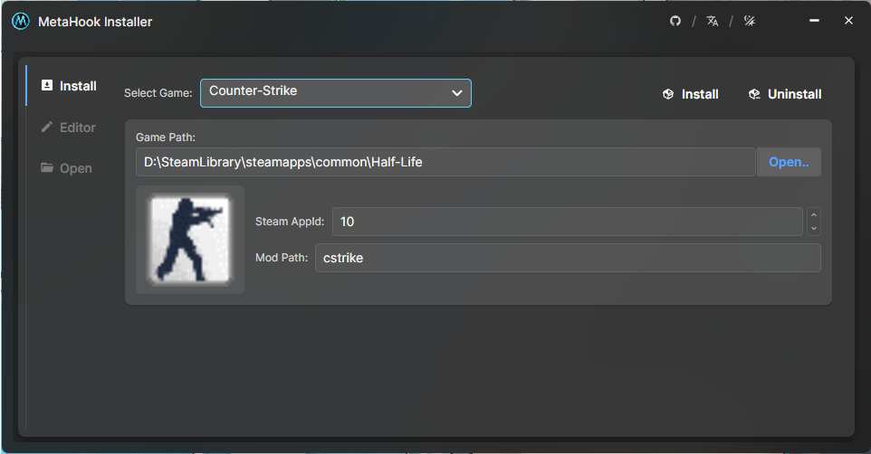
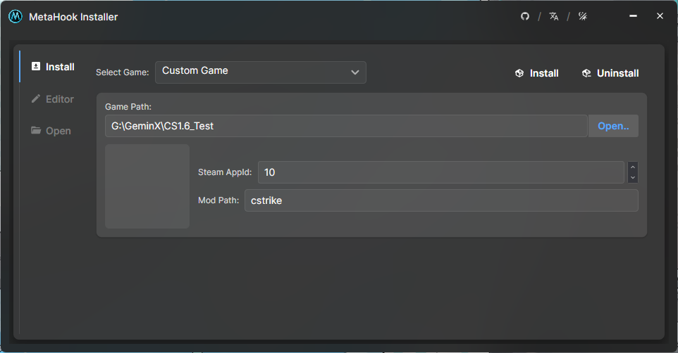
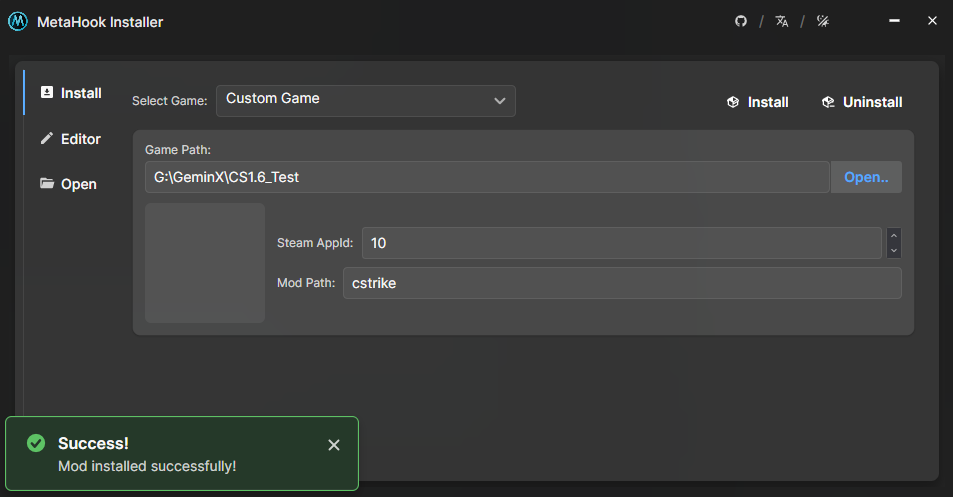
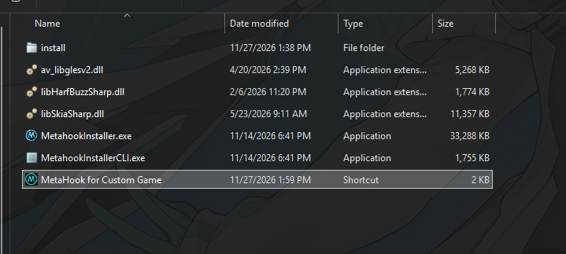
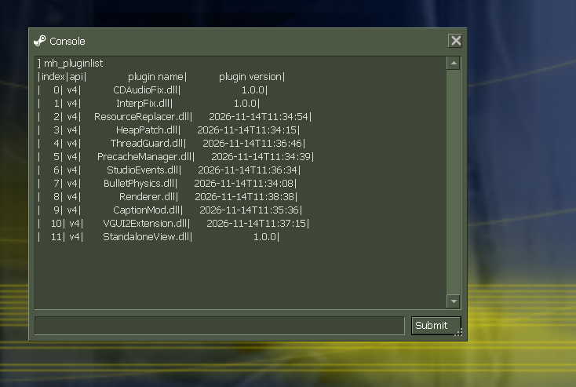

# Chapter I: Section B - MetaHook
## Guide to install MetaHookSv and Its Third Party Plugins.
> [!NOTE]
> This is a bit complicated step, make sure you followed carefully. A slight miss can lead to game crash/unstable.
> Don't rush it, take your time.

## $\color{BlueGreen}{MetaHookSv}$
#### $\color{GreenYellow}{Introduction}$
MetaHook is an addon for Goldsrc-based games to give extensive functionality (like ReHLDS and such). It works by using a special launcher that renames itself to match the game's executable, such as cstrike.exe, then loads the real game while injecting its own DLL early in the process. This DLL hooks into the engine's core functions, like rendering and input, using techniques such as inline patches and virtual table replacements. Once hooked, MetaHook loads plugins from a folder as DLL files, allowing them to add features like custom HUDs, improved lighting, shaders, and modern graphics effects. Because of that, MetaHook is heavily dependent with newer OpenGL and DirectX system, with moderate system specification (just to be safe). Unfortunately as I wrote this guide, MetaHook is for Windows only, which is have its specific requirements to be used for multiplayer/online mode (don't ask me how, I don't know either).

Very first MetaHook version is just "MetaHook" developed by Nagist. There's also "MetaHook Plus" version, I assume it's Nagist's fork for CS:BTE family of games. And finally, the latest and actively maintained version is "MetaHookSv" developed by hzqst, which is the one I'm using. It's originally developed for Svencoop, but it can be used for CS1.6 as well. MetaHookSv comes with its own set of plugins. [(list)](https://github.com/MetaHookSv/MetaHookSv#plugins)

#### $\color{GreenYellow}{System\ Requirements}$
- Read more [Here](https://github.com/hzqst/MetaHookSv/blob/main/docs/Renderer.md#gpu-requirement).

#### $\color{GreenYellow}{Installation\ Steps}$
1. Download MetaHookSv from [here](https://github.com/MetaHookSv/MetaHookSv/releases). 
2. Extract the package into a new, blank/separate folder.
> [!TIP]
> Avoid using spaces for name of that new folder, just in case something quirk happens.
3. Run the `MetahookInstaller.exe`.
4. Slightly different methods between to variants.
### Steam
If you're using the Steam version, it should detect automatically like this:

### NoSteam
If you're using NoSteam version, just navigate to your game folder. Write Steam AppId to `10` and Mod Path to `cstrike` like so:

5. After that, just click `install`. A green popup should appear if nothing goes wrong.

6. Back to the extracted MetaHookSv Installer folder, there should be a new shortcut showed. In this case is for NoSteam, but it should be named after the "Game" you choose earlier. You can move that shortcut file to desktop if you want.

7. Open that shortcut to launch the game with MetaHookSv.

8. Inside the game, press tilde `~` symbol on your keyboard, then type _`mh_pluginlist`_. If the output matches what's shown in the image below (or something similar), the MetaHook is successfully installed.

9. [OPTIONAL] Delete the `metahook` folder at `cstrike\addons\` to avoid confusion.

## $\color{BlueGreen}{Third\ Party\ Plugins}$ 
The plugins listed here are the plugins I have tried and used. When you have done installing third-party plugins, continue to [AMX Mod X installation](Chapter%20I%20-%20C.md).

> [!NOTE]
> Some MetaHook plugins may require AMX Mod X to be installed first.

#### $\color{GreenYellow}{General\ installation}$
MetaHook plugin installation is generally the same.
1. Download the plugin.
2. Find and copy the `.dll` file into `cstrike\metahook\plugins`.
3. Open `cstrike\metahook\configs\plugins.lst` with any text editor.
4. Write the `.dll` file name you just copied from the package (with the `.dll` text) on the very top of the list, then save it.
5. Read any additional info/steps if there's any.
6. Start the game and make sure the new MetaHook plugin is listed after you're typing _`mh_pluginlist`_.

Below, I will share my MetaHookSv plugins for Counter-Strike 1.6 only.
### $\color{ProcessBlue}{MetaUI}$
> [!NOTE]
> Requires AMX Mod X.

My personal and first MetaHookSv plugin which aimed to be complementary of my CCX plugin of AMX Mod X. As of now, it gives HUD enhancements mimicking CSO/CSN:S. It's still in beta phase, please report for bug(s) if you found any.

#### $\color{GreenYellow}{Installation\ Steps}$
1. Download from [here](https://gamebanana.com/mods/669466).
2. Extract the files into `cstrike` folder.
3. Install as written on the [general](#colorgreenyellowgeneral-installation) guide.
4. Open `cstrike/sprites/hud.txt`.
5. At the very top, change the number into a larger and reasonable number. (e.g. `512`)
6. Find any `buyzone`, `flash_`, and `c4` entries, then change `640hud7` string of them to `null`.
7. Compile `MetaUI_AddonPlugin.sma`, place the compiled file `MetaUI_AddonPlugin.amxx` into `plugins` folder, and write `MetaUI_AddonPlugin.amxx` into `configs/plugins.ini`. [Compiling Tutorial: [Local](https://forums.alliedmods.net/showthread.php?t=130511) or [Online](https://gamebanana.com/tuts/19340)]

### $\color{ProcessBlue}{Client\ Xtended}$
Client Xtended is a MetaHook Plugin to increase precache limit (you read it right) to around ~4096, and some quality improvements mimicking CSO. This plugin is made ***only*** for build 8684. Full feature list soon.

#### $\color{GreenYellow}{Installation\ Steps}$
1. Download from [here](https://gamebanana.com/mods/660356)
2. Install as written on the [general](#colorgreenyellowgeneral-installation) guide.
3. Open cstrike\delta.lst with any text editor.
4. Find every parameter that contains modelindex, viewmodel, weaponmodel, then change the value from 10 to 16, and save it.

Other known third party plugins are listed [here](https://github.com/MetaHookSv/MetaHookSv#plugins), under `(third-party)` tag.

:globe_with_meridians: [Telegram Channel](https://t.me/dxcave)\
:speech_balloon: [Telegram Chat Group](https://t.me/dxcave_chat)